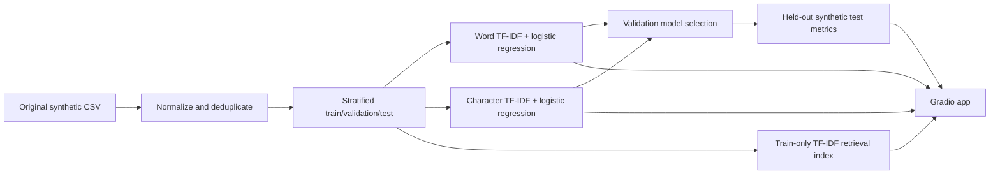

# DoubtLens AI — Intelligent Student Question Analysis

**Classify technical doubts. Discover related questions. Understand model performance.**

A reproducible Gradio ML application with a word TF-IDF/Logistic Regression baseline and a character n-gram TF-IDF/Logistic Regression challenger, per-class score breakdown, model-specific term explanation, cosine-retrieved questions, confusion matrices, and held-out error analysis. No secrets, paid APIs, or GPUs are needed for the packaged offline version.

> **Honest limitations:** All 600 bundled examples are project-authored **synthetic** questions. Performance on this synthetic task is not evidence of real-world generalization; templated data leaks structure across splits even after exact duplicate removal. Similarity search in the default deployment is TF-IDF cosine, **not** pretrained semantic embeddings. The optional sentence-transformer experiment is implemented separately and requires downloading model weights; it has not been trained or evaluated in this environment. Predictions are not verified answers and scores are not guaranteed calibrated.

## Features

- Multiline question input, choice of two trained classifiers, per-class probability estimates, uncertainty flag and feature contributions.
- Up to five similar training questions with explicit cosine similarities and synthetic provenance.
- Real test metrics, confusion plots, per-class precision, recall and F1, side-by-side comparison.
- Actual held-out misclassifications (where present), methodology and known limitations.
- Saved trained models and retrieval index for fast CPU start-up.

## Architecture



## Run locally

```bash
python -m pip install -r requirements.txt
python app.py
# open http://localhost:7860
```

Bundled model artifacts mean no training is required just to view the demo. To reproduce the results:

```bash
python scripts/generate_data.py
python scripts/train.py
python scripts/smoke_test.py
pytest -q
```

Optional embedding experiment (needs internet and several hundred MB of model/dependency downloads):

```bash
python -m pip install -r requirements-optional.txt
python scripts/train_embeddings.py
```

The optional experiment saves a classifier, train embeddings and measured scores separately. It does not automatically replace the offline app; CPU resource constraints and successful downloads must be confirmed before enabling it in a Space.

## Measured packaged results (held-out synthetic data only)

| Model | Accuracy | Macro F1 |
|---|---:|---:|
| Word TF-IDF | 0.9917 | 0.9917 |
| Character TF-IDF | 1.0000 | 1.0000 |

600 questions total; 360 training, 120 validation, 120 test. Selection on validation only. Results generated by code and recorded in `artifacts/metrics.json`.

## Hugging Face Spaces deployment

1. Sign in at https://huggingface.co and create **New Space**.
2. Choose a public Space, Gradio SDK, CPU Basic hardware, and a name like `doubtlens-ai`.
3. Upload **all files and directories** from this repository (including `artifacts/*.joblib` and `artifacts/metrics.json`). You can use the web uploader, or Git as described below.
4. Wait for the Space to build. Open the public URL displayed by Hugging Face. Verify classifier, search, and performance tabs.

Git workflow (replace placeholders with **your own** account and Space names):

```bash
git init && git add . && git commit -m "Build DoubtLens AI"
git branch -M main
git remote add origin https://huggingface.co/spaces/<YOUR_USERNAME>/<YOUR_SPACE>
git push -u origin main
```

Hugging Face may request an access token via its recommended Git authentication flow; **do not** paste credentials into a chat. A Space URL is only valid after publication and successful build. Example URL structure: `https://huggingface.co/spaces/<YOUR_USERNAME>/<YOUR_SPACE>`.

## GitHub

Create a blank public repository, then from this directory:

```bash
git init
git add .
git commit -m "Initial DoubtLens AI project"
git branch -M main
git remote add origin https://github.com/<YOUR_USERNAME>/doubtlens-ai.git
git push -u origin main
```

For screenshots, capture the actual deployed interface; no dummy screenshots are supplied.

## Structure

- `app.py`: Gradio UI.
- `src/doubtlens/core.py`: baseline/challenger training, inference, retrieval, evaluation.
- `src/doubtlens/embedding.py`: optional sentence-transformer experiment.
- `scripts/`: data generation, training, smoke testing.
- `data/samples/`: attributed original synthetic records.
- `data/processed/`: fixed-split saved data.
- `artifacts/`: compact trained models, local retrieval index and actual JSON metrics.
- `reports/`: measured charts and held-out errors.
- `tests/`: repeatable automated tests.
- `docs/`: dataset/model cards, methodology and deployment notes.
- `notebooks/`: exploratory notebook.

## Future work

Add licensed real programming questions with vetted labels; assess cross-template and near-duplicate leakage; develop out-of-distribution detection and confidence calibration; validate the optional pretrained embeddings using real semantic retrieval relevance judgments; benchmark inference on hosted CPU.

**Resume wording:** Built a reproducible Gradio NLP demonstration comparing word-level and character-level TF-IDF Logistic Regression classifiers for four student-question categories, with cosine-based question retrieval, held-out synthetic-data evaluation, confusion matrices, explanations and automated tests.
